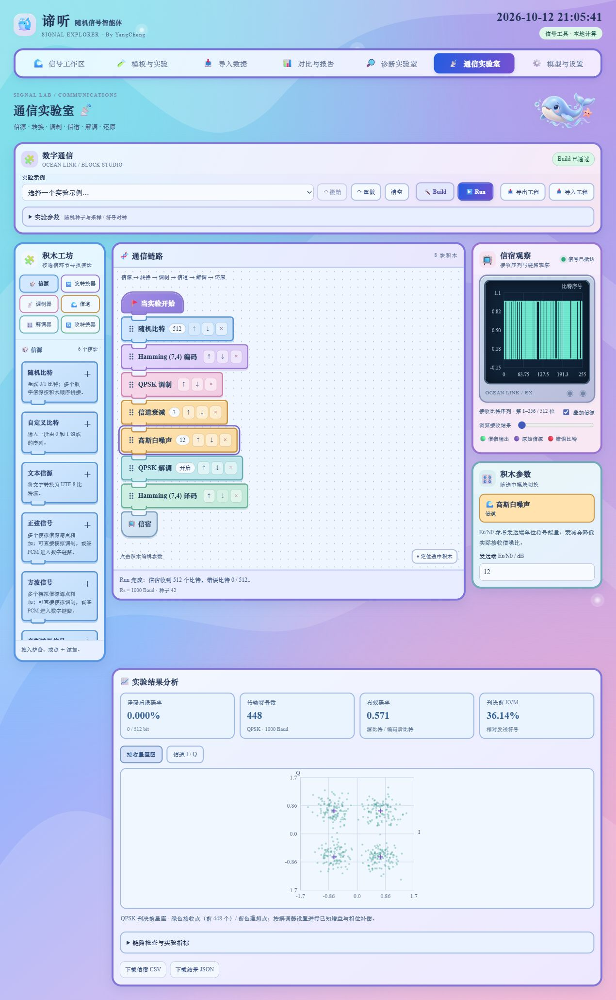
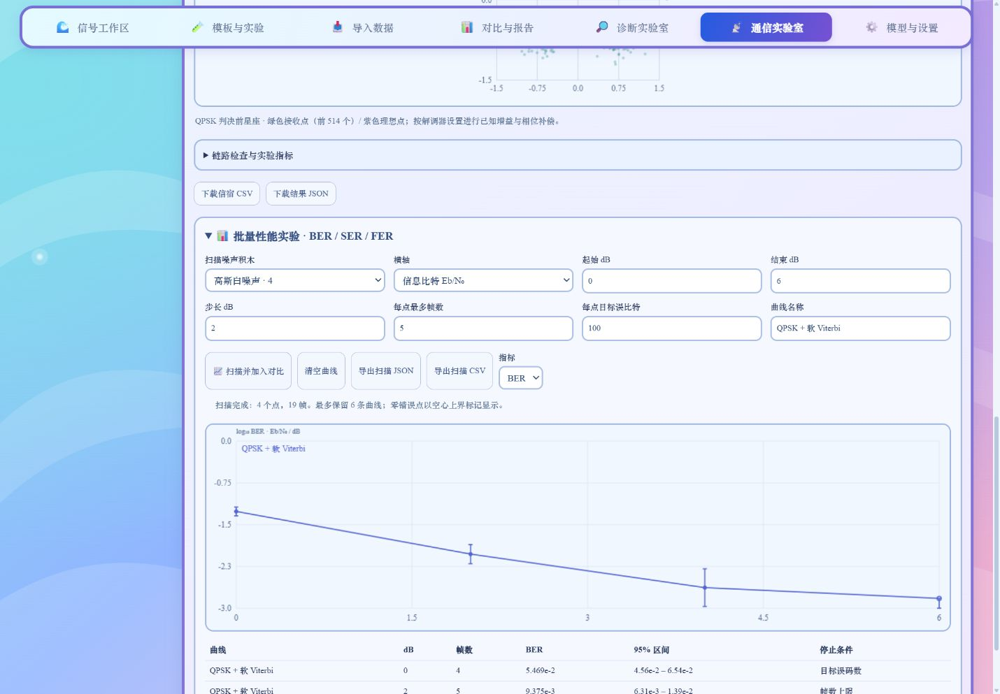
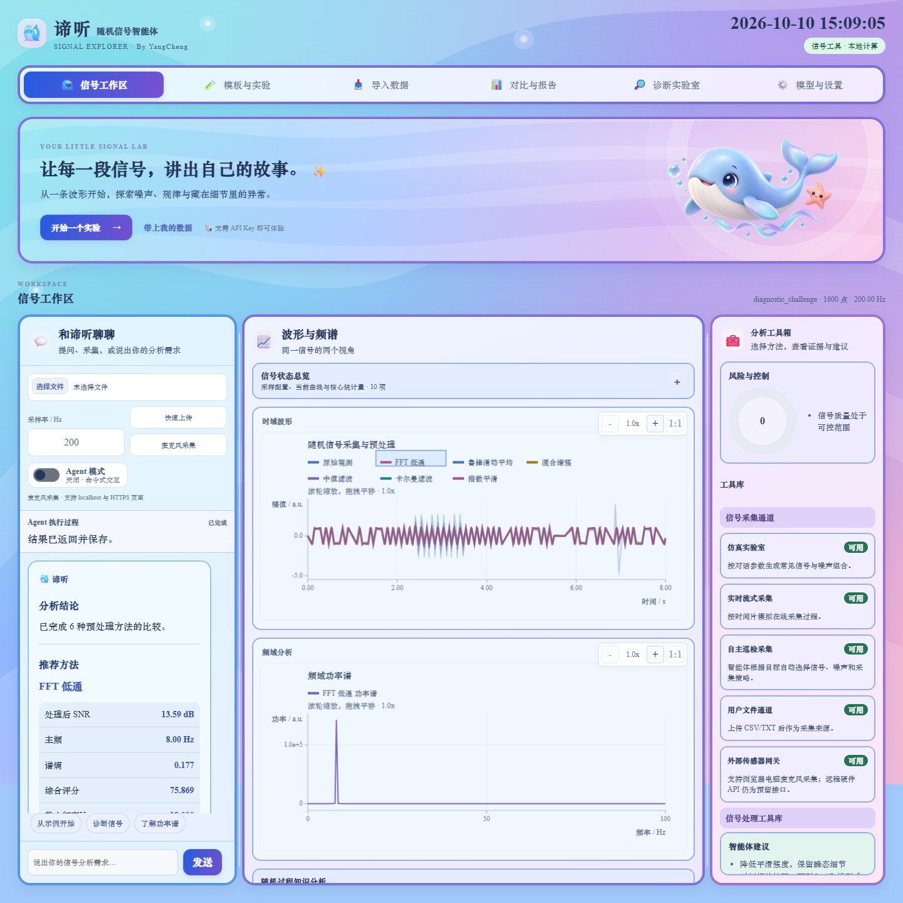
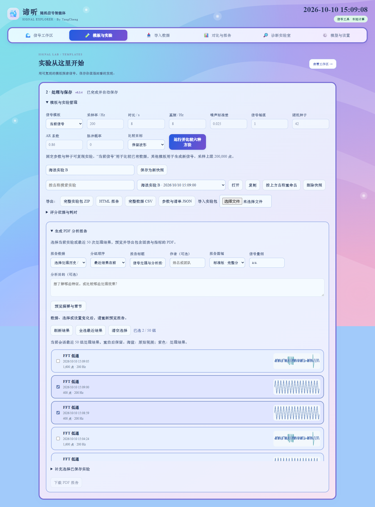
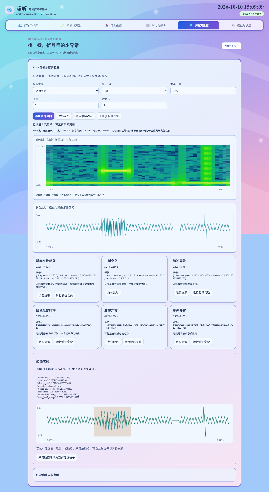
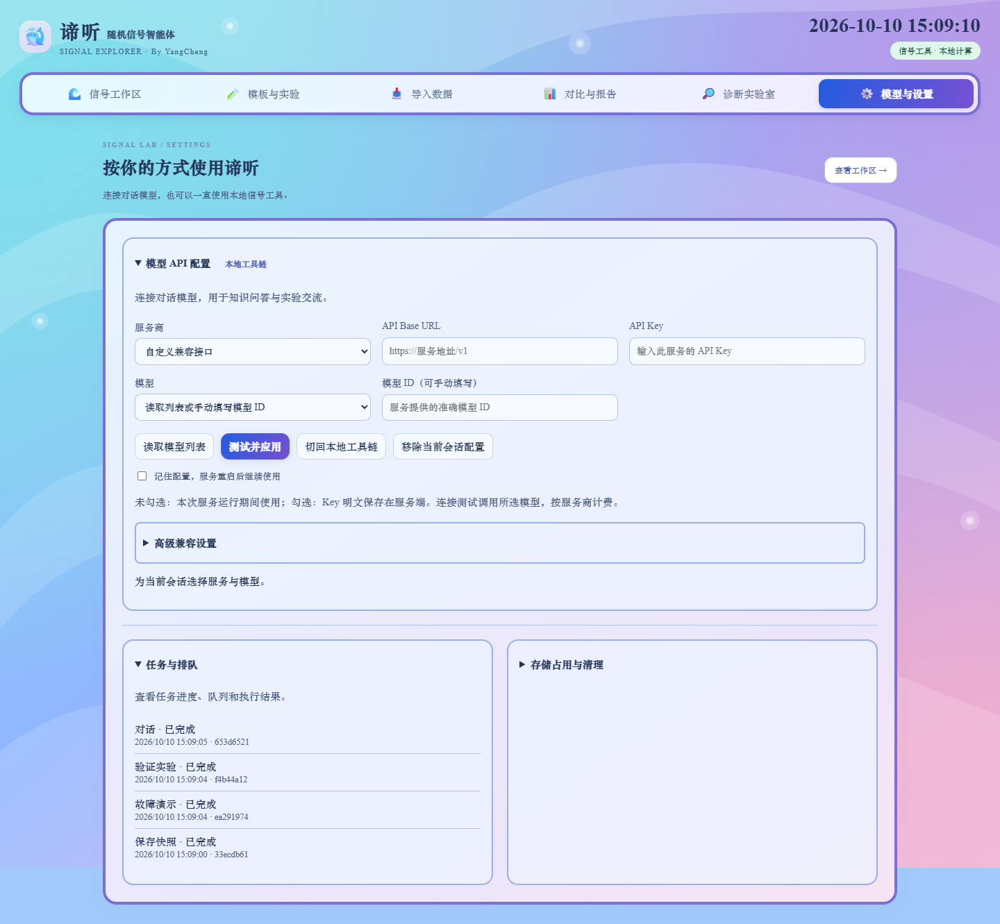
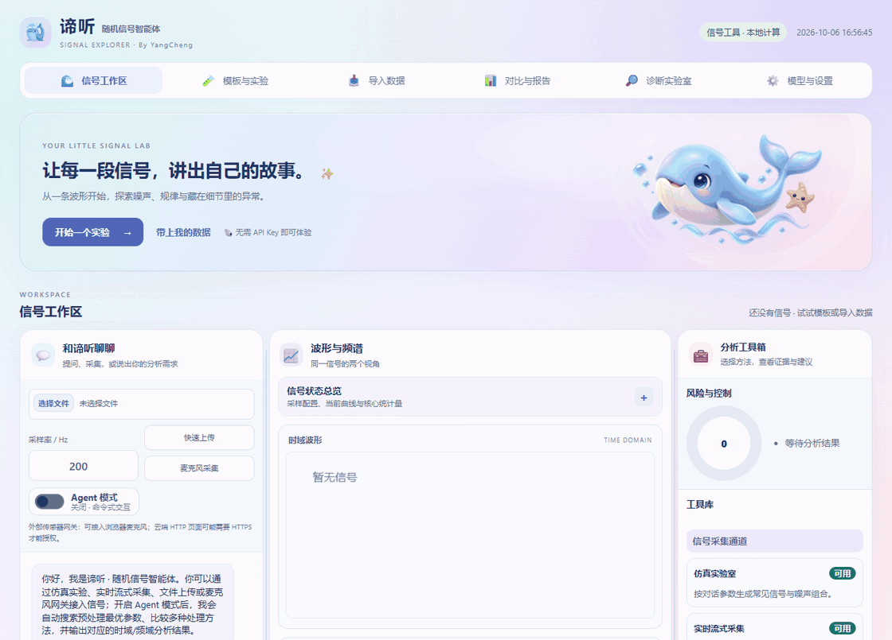
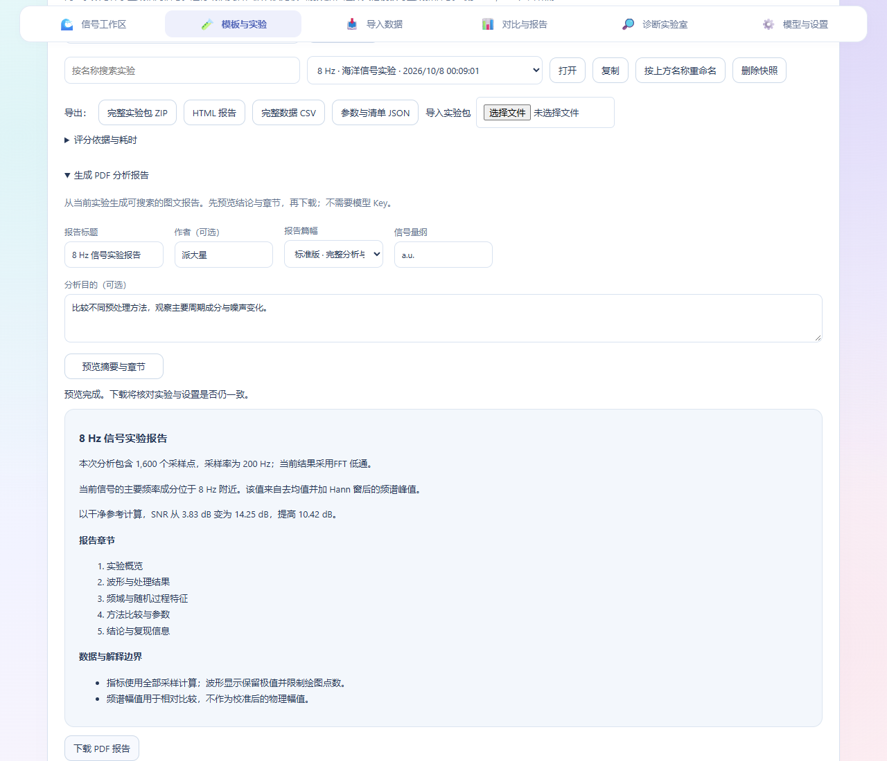
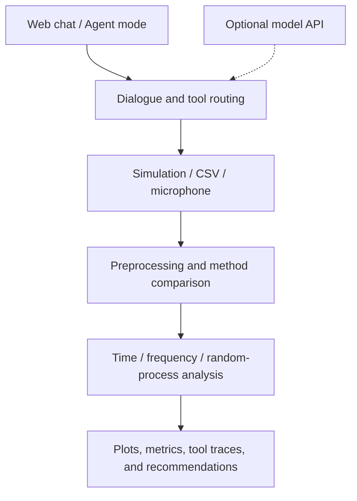

<div align="center">

# 🌊 Random Signal Agent · 谛听

[](https://github.com/PatrickStar-cmd/random-signal-agent/releases/latest)
[](RELEASE.md)
[](https://github.com/PatrickStar-cmd/random-signal-agent/actions/workflows/validate-deployment.yml)
[](LICENSE)

</div>

[简体中文 / English](README.md)

**💬 Analyze random signals through conversation. 🧩 Build communication pipelines with blocks.**

Diting brings Random Signals and Communication Principles experiments into one ocean-themed workspace. Generate noisy signals, compare filters and inspect time-frequency features, or connect coding, modulation, channel and receiver blocks to explore an end-to-end transmission.

🎓 Built for **UESTC Random Signals and Communication Principles coursework**, with local computation, seeded reproduction and optional model-assisted dialogue.

[🌐 Experiment preview](https://patrickstar-cmd.github.io/random-signal-agent/) · [📦 Download v0.4.3](https://github.com/PatrickStar-cmd/random-signal-agent/releases/tag/v0.4.3) · [📘 Installation guide](RELEASE.md)

## 🧭 Explore

| Get started | Learn more |
| --- | --- |
| [✨ Features](#en-features) | [🏗️ How it works](#en-workflow) |
| [📡 Communication lab](#en-communications) | [📘 Lab guide](工程文件/代码/docs/communications-lab.md) |
| [🎬 Interface](#en-interface) | [⚙️ Configuration](#en-configuration) |
| [🚀 Quick start](#en-quick-start) | [📊 Example results](#en-results) |
| [🧪 First experiment](#en-first-experiment) | [🔧 Troubleshooting](#en-troubleshooting) |
| [📚 Documentation](#en-documentation) | [🤝 Contributing](#en-contributing) |

<a id="en-features"></a>

## ✨ Features

| Capability | What you can do |
| --- | --- |
| 🐳 Ocean UI | Layered ocean/lilac gradients and AI-generated 3D whale art for desktop, tablet and mobile. |
| 📡 Communication lab (v0.4.3) | 122 blocks and 49 presets: soft decoding, complete digital receivers, fading, OFDM and BER/SER/FER sweeps. |
| 🔑 Model API setup | Choose a provider/model, enter a key and test/apply in the UI; optional per-session persistence. |
| 📄 PDF analysis reports (v0.4.3) | Preview and export Chinese brief/standard reports with vector plots, measured metrics, optional diagnosis and reproduction details. |
| 🩺 Diagnostic laboratory | Linked STFT and event timeline, six seeded fault types, blind challenge evaluation, and reversible evidence-based processing trials. |
| 💾 Experiment workbench | Create from templates, save, reopen, duplicate, search, rename or delete snapshots, and resume after a restart. |
| 📥 Data import wizard | Preview CSV/TXT, select time and signal columns, convert time units and locate invalid rows. |
| 🔍 Snapshot comparison | Overlay 2–4 saved results, compare parameters and metrics, and download a standalone HTML report. |
| ⏳ Tasks and storage | Inspect the queue, cancel work at safe checkpoints, unload idle sessions and clean unreferenced sample files after preview. |
| 📦 Data and reports | Export full-resolution CSV, standalone HTML reports, manifests and portable experiment ZIPs. |
| 🧮 Explainable comparison | Choose denoising, waveform or transient preservation; inspect score terms, parameters and timings. |
| 🎲 Reproducible simulation | Set sample rate, duration, frequency, noise, and random seed. |
| 🧹 Six preprocessing methods | Compare robust moving average, median, exponential smoothing, FFT low-pass, hybrid, and Kalman filtering. |
| 📈 Time and frequency analysis | Inspect statistics, FFT peaks, correlations, and spectral features. |
| 🔬 Random-process analysis | Explore AR models, Welch power spectra, and residuals. |
| 🤖 Agent mode | Compare methods and parameters automatically, inspect tool traces, and review recommendations. |
| 🎙️ Multiple inputs | Analyze simulated signals, CSV/TXT samples, or browser microphone audio; download processed audio. |

<a id="en-communications"></a>

## 📡 Communication-principles lab · Build a transmitter and receiver with blocks

Drag in blocks, edit their parameters, click **🔨 Build** to check the pipeline, then **▶️ Run** to inspect the transmission. Six block categories provide **122 modules + a fixed sink and 49 presets**.

**🎲 Sources → 🔀 Transmit converters → 📡 Modulators → 🌊 Channels → 🎛️ Demodulators → 🔄 Receive converters → 📺 Sink**

| Module | Included techniques |
| --- | --- |
| 🎲 Sources | Random/custom bits, UTF-8 text, sine, square and Gaussian sources; PRBS7/9/15 m-sequences and correlation views. |
| 🔀 Transmit converters | Uniform/companded PCM, DPCM and delta modulation; repetition, Hamming, convolutional and LDPC coding, CRC, scrambling, interleaving and ten line codes. |
| 📡 Modulators | BPSK/QPSK/16QAM, OOK/2ASK, 2FSK, DBPSK/DQPSK, MSK/GMSK; AM/DSB-SC/SSB/VSB/FM/PM, PAM; real/complex pulse shaping, preambles, pilots and OFDM/IFFT/CP. |
| 🌊 Channels | AWGN, band limits, attenuation, phase shifts, erasures, AC coupling, ISI and clock/timing offsets; carrier offset, phase noise, unknown frame delay, complex multipath and Rayleigh/Rician fading. |
| 🎛️ Demodulators | Paired demodulation and PSK/QAM LLRs; matched filtering, symbol/carrier/frame recovery, ZF/MMSE/DFE, real/complex LMS/NLMS/RLS, CMA, pilot LS and OFDM/FFT/frequency-domain equalization. |
| 🔄 Receive converters | Line decoding, deinterleaving, descrambling, CRC checks, repetition/Hamming correction, hard/soft Viterbi, iterative LDPC and PCM/companding/DPCM/delta reconstruction. |
| 📺 Sink | Received bits, text and analog waveforms, with source overlays, bit-error markers and full-sequence browsing. |

- 🧩 **Build and edit:** an ocean-themed palette, compact connected blocks and a parameter inspector; drag/drop, reordering, undo/redo, draft recovery and project JSON import/export.
- 📈 **Inspect and save:** processing-stage waveforms, preamble correlation, OFDM grids, eyes and recovery traces; seeded BER/SER/FER sweeps, Eb/N₀ calibration, 95% intervals, curve comparisons and full JSON/CSV export.



🆕 [v0.4.3 algorithms and experiments](工程文件/代码/docs/communications-v043.md)



📚 [Lab guide](工程文件/代码/docs/communications-lab.md) · [Analog modulation](工程文件/代码/docs/analog-modulation.md) · [Line codes and channels](工程文件/代码/docs/baseband-coding.md) · [Timing and equalization](工程文件/代码/docs/receiver-recovery.md)

<a id="en-interface"></a>

## 🎬 Interface

v0.3.4 uses cyan, lavender and coral-pink gradients, 4 px outer borders and 2 px inner borders. Chinese text uses STZhongsong when installed; Latin text and numbers use Times New Roman. A larger, bold clock sits above the local-computing badge. Agent method comparisons separate conclusions, recommended metrics and next steps. Switching between the six views preserves inputs and experiment state.

These captures show v0.3.4, including the visual update shipped in its deployment ZIP. Fonts are loaded from the visitor’s computer, with serif fallbacks when unavailable.



<details>
<summary><strong>Explore templates, diagnostics and API setup</strong></summary>

**Templates and experiments**: compare six methods, save named snapshots and import/export full experiment packages.



**Diagnostic laboratory**: inspect linked time-frequency and waveform plots, locate events and verify processing trials.



**Models and settings**: choose your provider, model and persistence options in the browser.



</details>

<details>
<summary><strong>Watch the ocean walkthrough (v0.3.0)</strong></summary>

Agent acquisition and analysis → save a snapshot → inspect fault diagnostics → open model settings. The walkthrough uses the local signal tools.



</details>

## 📄 Export a PDF analysis report

After collecting or restoring an experiment, open **模板与实验 → PDF 分析报告 (Templates & Experiments → PDF report)**. Set the title, author, purpose, units and brief/standard edition. Select **预览摘要与章节** to review the summary, then **下载 PDF** to download.

Reports currently use Chinese. Standard reports include waveform metrics, FFT, Welch PSD, autocorrelation, existing method comparisons/diagnostics and reproduction details; brief reports focus on the overview, key metrics, waveform and FFT. Narrative statements use the measured data and require no model key. True SNR/RMSE need a clean reference, and blind experiments must be revealed first.



[Example PDF](docs/report-example.pdf) · [Report guide (Chinese)](工程文件/代码/docs/pdf-report.md)

**New in v0.3.2:** Select up to 50 recent processing results, optionally include saved snapshots, and arrange them chronologically. Export one PDF with a shared cover, summary, clickable contents and plots for every group. History survives server restarts; older unsaved results cannot be recovered.

<a id="en-quick-start"></a>

## 🚀 Quick start

Use **Python 3.12–3.14** or **Docker Compose v2**. v0.4.3 uses FastAPI; deployment checks cover Python 3.12–3.14 on Windows and Linux, plus Docker on Linux.

### 1. Get the project

Download the v0.4.3 [deployment ZIP](https://github.com/PatrickStar-cmd/random-signal-agent/releases/download/v0.4.3/random-signal-agent-v0.4.3-deploy.zip) and extract it, then open a terminal in `工程文件/代码` inside the extracted folder.

Or clone the repository:

```bash
git clone https://github.com/PatrickStar-cmd/random-signal-agent.git
cd "random-signal-agent/工程文件/代码"
```

### 2. Install and start

**Windows PowerShell** — use Python 3.12–3.14:

```powershell
python -m venv .venv
.\.venv\Scripts\python.exe -m pip install -r requirements-repro.txt
.\.venv\Scripts\python.exe server.py --host 127.0.0.1 --port 8000
```

**Linux / macOS**

```bash
python3.12 -m venv .venv
.venv/bin/python -m pip install -r requirements-repro.txt
.venv/bin/python server.py --host 127.0.0.1 --port 8000
```

<details>
<summary><strong>Run with Docker instead</strong></summary>

From the same `工程文件/代码` directory:

```bash
cp .env.example .env
docker compose up -d --build --wait --wait-timeout 120
```

On Windows, replace the first command with `Copy-Item .env.example .env`. Uploads and generated outputs persist in local folders. Use `docker compose logs --tail 100` to inspect the service and `docker compose down` to stop it.

</details>

### 3. Open the application

Visit **<http://127.0.0.1:8000>**. Simulation, filtering, and analysis are available without configuring an external model.

The [online preview](https://patrickstar-cmd.github.io/random-signal-agent/) shows the saved experiment and interface captures. Interactive experiments run with the Python backend.

<a id="en-first-experiment"></a>

## 🧪 Your first experiment

1. Open **信号工作区 (Workspace)**. Enable **Agent mode** to compare six preprocessing methods automatically, then enter this command. The local command parser supports Chinese:

   > 采集一段 8 秒、采样率 200Hz、主频 8Hz 的正弦信号加高斯噪声，随机种子 42

   This creates an 8-second sine signal with Gaussian noise at 200 Hz, with an 8 Hz target frequency and seed 42.

2. Inspect the waveform, spectrum and statistics. In command mode, continue with:

   > 使用滑动平均预处理并分析时域和频域特征

   This applies a moving average and analyzes time/frequency features.

3. Open **模板与实验 (Templates)**, enter a name and save a snapshot. Export an experiment ZIP to restore full samples, results and tool records later. Successful operations automatically save the current experiment. After running or restoring, comparisons reuse current data; select another template to generate a new signal.
4. For your own data, open **导入数据 (Import)** and upload UTF-8 CSV/TXT. Select the time/signal columns and time unit, or enter a sample rate when no time column exists. Confirm the preview, then compare and save results in Templates.
5. Open **对比与报告 (Comparison)**, select 2–4 snapshots and inspect overlays and metrics or download an HTML report. Scores are directly comparable only when inputs, references, goals and scoring versions match.

For anomaly detection, save your current experiment before loading the fault demo in **诊断实验室 (Diagnostics)**. Inspect evidence, select an interval and verify a processing trial. Adopt a result and save it as a snapshot. Blind mode hides truth and reference error until reveal and restricts full experiment export and comparisons; the diagnostic report remains available.

External models are optional. Open **模型与设置 → 模型 API 配置 (Settings → Model API)**; see Configuration below.

Keep the same parameters and seed to reproduce simulated samples. The import wizard selects one signal from multicolumn data. Quick upload reads a single value column or the first two columns as time in seconds and values; see the [data guide](docs/README.en.md).

<a id="en-workflow"></a>

## 🏗️ How it works



| Component | Responsibility |
| --- | --- |
| `web/chat.html` + `server.py` | Web interface, uploads, HTTP endpoints, and streamed responses. |
| `src/dialogue_agent.py` | Interpret tasks and coordinate the signal tools. |
| `src/acquisition.py` | Acquire simulated signals, uploaded samples, and audio. |
| `src/preprocessing.py` | Filter signals and compare candidate methods. |
| `src/analysis.py` + `src/advanced_analysis.py` | Calculate time, frequency, and random-process features. |
| `src/llm_client.py` | Connect to an optional Chat Completions-compatible service. |

All component paths are relative to `工程文件/代码`.

<a id="en-configuration"></a>

## ⚙️ Configuration

The local toolchain is the default. To connect an external model, open **模型与设置 → 模型 API 配置 (Settings → Model API)**:

1. Choose OpenAI, DeepSeek or a custom Chat Completions-compatible provider and enter its key.
2. Load the model list and select a model, or enter the exact model ID manually.
3. Choose **测试并应用 (Test and apply)**. The current browser session updates immediately without restarting; you can switch back to local tools or remove the configuration.

Keys stay in server memory by default. Opting into restart persistence stores them in plaintext in `data/model-settings.sqlite3`. Browser storage, experiment ZIPs and task history contain no keys. See the [model setup guide](工程文件/代码/docs/model-api-setup.md) for compatibility, persistence and advanced parameters.

<details>
<summary><strong>Server defaults and startup scripts</strong></summary>

Administrators can copy `config/server.env.example` to `config/server.env` to set service-wide defaults. Per-session configuration takes precedence.

| Setting | Purpose |
| --- | --- |
| `RS_AGENT_HOST` / `RS_AGENT_PORT` | Server bind address and port; use `127.0.0.1` for local access. |
| `RS_AGENT_LLM_BASE_URL` | Model API base URL, such as `https://your-provider.example.com/v1`. |
| `RS_AGENT_LLM_MODEL` | Model identifier accepted by your provider. |
| `RS_AGENT_LLM_API_KEY` | Your provider's API key. |
| `RS_AGENT_LLM_TIMEOUT` | Model request timeout in seconds; default: `45`. |
| `RS_AGENT_LOG_FILE` | Startup-script log path; default: `logs/server/server.log`. |

After activating the virtual environment, use `scripts/start_server.ps1` on Windows or `bash scripts/start_server.sh` on Linux/macOS to load this file. Directly running `server.py` does not load `config/server.env`.

Docker Compose reads `.env` in the code directory. See the [deployment guide](工程文件/代码/DEPLOY.md) for Docker settings, HTTPS hosting, and service management.

</details>

<a id="en-results"></a>

## 📊 Reproducible example

The saved showcase uses a random process with mixed noise: **200 Hz**, **8 seconds**, **1,600 samples**, an **8 Hz** target frequency, and **seed 42**. A robust moving average uses a 7-sample window.

| Metric | Result |
| --- | ---: |
| Detected dominant frequency | 8.000 Hz |
| Original SNR | 2.859 dB |
| Processed SNR | 4.781 dB |
| SNR improvement | 1.922 dB |

Results depend on the input signal and filter parameters.

[Sample CSV](docs/data/sample.csv) · [Analysis results](docs/data/result.json) · [Experiment configuration](工程文件/代码/config/showcase.json) · [Reproduction guide](docs/README.en.md)

<details>
<summary><strong>Check your deployment</strong></summary>

With the application running, open another terminal in `工程文件/代码` and use the same Python environment:

```powershell
# Windows
.\.venv\Scripts\python.exe scripts/smoke_deployment.py --base-url http://127.0.0.1:8000
```

```bash
# Linux / macOS
.venv/bin/python scripts/smoke_deployment.py --base-url http://127.0.0.1:8000
```

The check covers the application version, ocean assets, model settings API, Agent mode, streaming, import/export, diagnostics and PDF download. Its result is written to `logs/deployment/latest.log`. Release assets also include `SHA256SUMS.txt` and `verification.json`.

</details>

<a id="en-troubleshooting"></a>

## 🔧 Troubleshooting

| Question | Answer |
| --- | --- |
| Why does the online preview not run new experiments? | GitHub Pages serves the saved showcase. Start the backend locally or deploy it with Docker for interactive use. |
| Do I need an API key? | The local signal tools do not require one. Model-assisted dialogue is optional. |
| Which Python versions work? | v0.4.3 supports Python 3.12, 3.13 and 3.14. |
| Why can I not activate the virtual environment on Windows? | The quick-start commands call `.venv\Scripts\python.exe` directly and do not require activation. |
| Why is the microphone unavailable? | Open the app on localhost or HTTPS and allow microphone access in the browser. |
| Why does my uploaded signal have no SNR value? | Reference-based SNR requires a clean signal. Uploaded samples and microphone audio do not provide that reference. |
| What if port 8000 is occupied? | Start with `--port 8001`, then open `http://127.0.0.1:8001`; update the smoke-check URL too. |

<a id="en-documentation"></a>

## 📚 Documentation

| Guide | Contents |
| --- | --- |
| [PDF report guide](工程文件/代码/docs/pdf-report.md) | Report options, preview, sections and measured evidence (Chinese). |
| [Model API setup](工程文件/代码/docs/model-api-setup.md) | Browser configuration, key persistence and compatibility. |
| [UI guide](工程文件/代码/docs/ui-design.md) | Six-view navigation, responsive layout and controls. |
| [Installation & release](RELEASE.md) | Deployment ZIP, platform commands, and checksums. |
| [Experiment guide](docs/README.en.md) | Saved data, parameters, file formats, and reproduction. |
| [Code overview](工程文件/代码/README.md) | Modules and model configuration. |
| [Communication lab](工程文件/代码/docs/communications-lab.md) | Block pipelines, Build/Run, metrics, exports and baseband model (Chinese). |
| [Running & configuration](工程文件/代码/docs/exec.md) | Commands, settings, and logs. |
| [Features & validation](工程文件/代码/docs/review.md) | Implemented capabilities, checks, and current limits. |
| [Algorithm principles](工程文件/代码/docs/principle.md) | Signal-processing methods and analysis. |
| [Deployment](工程文件/代码/DEPLOY.md) | Docker, HTTPS, systemd, and health checks. |
| [Changelog](CHANGELOG.md) | Release history. |

The code and algorithm guides are in Chinese.

<a id="en-contributing"></a>

## 🤝 Contributing

Issues and pull requests are welcome for bug fixes, signal-processing methods, experiment examples, and documentation. For a bug report, include your Python version, input parameters, steps to reproduce, and relevant logs. For an algorithm change, include a reproducible signal and a before/after comparison.

[Open an issue](https://github.com/PatrickStar-cmd/random-signal-agent/issues) · [View pull requests](https://github.com/PatrickStar-cmd/random-signal-agent/pulls)

## 📄 License

Licensed under the [MIT License](LICENSE). Retain the license and copyright notice when using, modifying, or distributing the project. Third-party dependencies and assets retain their respective licenses.
