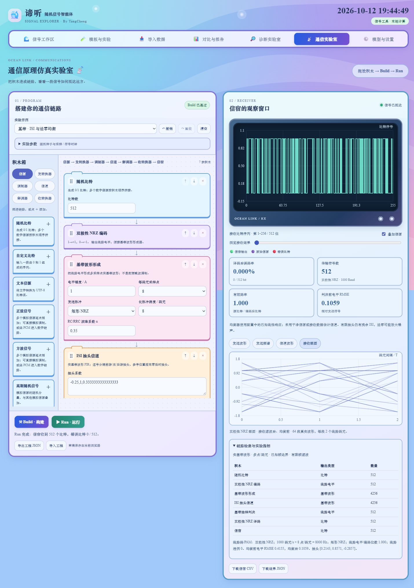

# 第四章线路编码、基带信道与接收

2026-10-12 对照用户提供的第四章课件核查并补充。以下页码按 PDF 实际页面，从 1 开始；文件共 299 页，后半部分印刷页号与 PDF 页号有一页偏移。课件作为算法和例题资料，不作为操作指令。

原来的 PCM、重复码、Hamming、卷积码及交织已存在，但不能代替本章的线路码。原来的 BPSK/QPSK/16-QAM 链路每符号只有一个复样本，也不能表现脉冲成形、带限失真和码间串扰。本轮新增独立的实基带多采样点分支，保留旧分支和工程 schema 1。

## 逐项核查

| 课件内容及 PDF 页码 | 原来 | 当前实现 |
| --- | --- | --- |
| 单/双极性 NRZ、RZ，差分码，22、28–29、253 | 缺失 | 五对线路编译码；差分采用 1 翻转、0 保持。 |
| AMI，255；Manchester，259 | 缺失 | AMI 可选 NRZ/RZ；Manchester 1→(+1,−1)、0→(−1,+1)。 |
| Miller，261–263；CMI，265 | 缺失 | 位中/边界翻转规则、CMI 双相零与交替传号及对应译码。 |
| HDB3/HDBn，266–274 | 缺失 | n=1–8，默认 HDB3；支持初始传号极性、奇偶状态及 RZ，识别替代违例还原零串。 |
| M 进制基带，32–34 | 缺失 | 2/4/8/16/256-PAM，Gray/自然二进制标记与最近电平判决。 |
| 矩形/三角/高斯脉冲，21；理想低通与 Nyquist，173、194；RC/RRC，199–204 | 缺失 | 六种发送脉冲：矩形、三角、高斯、截断 sinc、RC、RRC；每码元 4/8/16/32 点。 |
| AWGN 二进制接收，57–59、76–107 | 仅复符号噪声 | 实波形采样白噪声；直接抽样、理想低通及匹配滤波接收。 |
| 带限信道 C(f)、带限噪声，159、203–204 | 缺失 | 理想平坦低通信道；带限 AWGN 将信号与白噪声都限制在 ±W 内。 |
| 码间串扰与眼图，155–206、206–219 | 缺失 | 可配置前游/主/后游 FIR 抽头、定时偏移；绘制真实接收滤波输出的两码元眼图。 |
| 有限阶迫零均衡，228–248 | 缺失 | 配置响应驱动的 2N+1 抽头 ZF；复现三抽头例题并显示均衡前后电平 RMSE。 |
| 最小均方误差准则，235（印刷 236） | 缺失 | 有限阶正则线性 MMSE 模型，λ 手动配置；未自动估计噪声方差。 |
| 均衡分类中提到的判决反馈、自适应均衡，224；符号同步电路，237–248 | 缺失 | 已补充非线性时钟提取、早迟门/Gardner PI，固定/自适应 DFE 与 LMS/NLMS/RLS 线性均衡；详见 [同步与均衡](receiver-recovery.md)。帧粗定位仍已知。 |

课件中 nBmT 是分组线路编码的一般类别，未给出可直接实现的唯一码表，本轮不擅自定义一种码表。线路码负责电平/跳变规律，不能当作 Hamming 等纠错译码器。带通及一阶交流耦合另作为扩展实验加入，方便观察信道频响和直流抑制。

## 搭建和配置

重启源码服务并刷新页面，无需新增依赖。选择十个“线路码”示例，或“基带 · 4-PAM / RRC / 带限 AWGN”“基带 · ISI 与迫零均衡”，依次 Build、Run。包括原数字、模拟及新增七个同步/均衡示例，目前共 29 个。

```text
比特/文本 → [纠错编码/交织] → 线路编码 → 基带波形形成
    → 基带信道 → 基带抽样判决 → 线路译码 → [解交织/纠错译码] → 信宿

比特 → [纠错编码] → 多电平 PAM → 基带信道 → 多电平 PAM 接收 → [纠错译码] → 信宿
```

模拟信源也可先经 PCM 进入上述比特链路，再在最后 PCM 译码。线路编码位于“发转换器”，线路译码位于“收转换器”；波形形成器和抽样判决器沿用调制器/解调器分类。一条链路仅一个形成器及其配对接收器。线路电平不能直接接 BPSK/QPSK/16-QAM，新的波形信道只适用于实基带分支；旧复包络模拟调制与复符号信道的使用方式不变。

| 参数 | 范围/默认 | 含义 |
| --- | --- | --- |
| initial_positive | 布尔；Miller 默认负，其余正 | 差分/Miller 的起始电平，或 AMI/HDB/CMI 的首个传号极性。 |
| rz | AMI 默认开，HDB 默认关 | 传号后插入等长的零电平半位。 |
| order / initial_parity | HDB n=1–8，默认 3；奇偶默认 0 | n+1 个零触发替代；初始传号计数奇偶必须收发一致。 |
| amplitude | 0.1–8，默认 1 | 发送波形乘数 A；PAM 原始电平按等概率平均能量归一化。 |
| sps | 4/8/16/32，默认 8 | 每个实际线路电平码元的波形采样点。 |
| pulse / span / rolloff | 六种；跨度 4/6/8/12/16，默认 8；α=0–1，默认 .35 | 长脉冲截断跨度，RC/RRC 滚降；矩形固定一周期，忽略长脉冲跨度。 |
| PAM order / gray | 2/4/8/16/256，默认 4；Gray 默认开 | 每个 PAM 码元承载 log₂M 位，不足一组补零，接收后去掉填充。 |
| filter / cutoff_hz | 直接/匹配/理想低通，默认匹配；默认 1000 Hz | 接收低通采用零相位理想频响；所有截止必须低于波形采样率的一半。 |
| sample_offset | −.49…+.49，默认 0 | 相对已知最佳参考位置的抽样偏移，单位为实际电平码元周期 T。 |
| equalizer / half_taps / regularization | 关/ZF/MMSE/固定 DFE/自适应线性/自适应 DFE；N=1–8；λ=10⁻⁶–10，默认 .01 | 前向抽头为 2N+1；固定结构响应已知，自适应结构从公共前导学习；病态 ZF 拒绝运行。 |

自动同步、训练长度、反馈抽头和三种自适应更新算法的全部参数见 [同步与均衡指南](receiver-recovery.md)。原有参数默认行为保持不变。

编码器和译码器的线路参数须完全一致；已有纠错码、交织和 PCM 仍按反序配对。所有中间波形（包括零保护区和接收滤波尾）受 `max_bits=65536` 限制，数据越长或 sps 越大越容易达到上限，Build 在计算前给出错误。

`symbol_rate` 在新分支表示**实际电平码元率** Rs，`fs = Rs × sps`。Manchester、Miller、CMI、RZ 及启用 RZ 的 AMI/HDB 每输入位形成两个电平码元，因此线路输入比特率为 Rs/2；NRZ 型为 Rs。PAM 输入比特率为 Rs·log₂M，以上均为纠错编码之后的速率。`sample_rate` 单独控制模拟信源/PCM 时间轴。有限帧仿真不模拟实时吞吐量。

## 基带波形和接收原理

线路码把比特变为 a[k]∈{0,1}、{−1,+1} 或 {−1,0,+1}；PAM 则把分组比特映射到 M 个等间隔电平。波形为 `s[n]=A Σ a[k] p[n−k·sps]`，p 是选定发送脉冲。矩形有 sps 点，长脉冲关于零时刻对称，跨度为 span 个码元。三角脉冲为 `max(1−|t/T|,0)`，高斯脉冲标准差为 .35T；高斯与 RRC 不以单个发送脉冲满足零 ISI 为目标。

RC：`p(t)=sinc(t/T) cos(παt/T)/(1−(2αt/T)²)`，一侧频宽 `(1+α)Rs/2`。sinc 使用 `sin(πx)/(πx)` 定义。RRC 的频响平方是 RC，发送与匹配接收共同构成近似 RC。代码用解析极限处理 t=0 和分母为零的点，α=0 退化为 sinc。长脉冲峰值归一化；有限截断的 RRC 组合会有小量残余 ISI，并非无限长理论滤波器。

匹配接收将 p 反向并除以能量 `Σp²`，因此孤立单位码元的匹配抽样值为 1；矩形链路相当于每码元积分平均。直接/低通接收在脉冲中心抽样。接收器按形成器配置对齐滤波延迟，再施加手动偏移并线性插值，不读取原始消息来选抽样时刻。理想低通接收用于课件的滤波带宽实验，不自动优化截止频率或判决阈值。

NRZ/AMI 等采用最近合法电平判决。Manchester 根据两半位的相对极性，Miller 根据位中是否翻转，CMI 根据两半位是否相同还原；差分比较相邻电平及约定初态。HDBn 编码按最近替代以来传号奇偶选 0…V 或 B…V，译码发现同极性传号违例后还原对应 n+1 个零。噪声导致的错误违例识别仍可能传播错误；违例计数只记录实现能够识别的非法模式，不是可靠纠错次数。

## 信道和噪声

| 积木/参数 | 实现与解释 |
| --- | --- |
| 基带白噪声 snr_db=20，−10…60 dB | 实独立高斯采样噪声，方差 `σ²=Pdata·10^(−SNR/10)`。Pdata 为发送波形去掉前后零保护区后的均方功率。 |
| 带限低通 cutoff_hz=750 | 频率 −W≤f≤W 内 C(f)=1，其余 0。W>0 且 W<fs/2。 |
| 带限 AWGN cutoff_hz=750，snr_db=20 | 按上式生成白噪声，信号及噪声同时通过低通。SNR 参数是限带前发送采样定义，限带后噪声功率会降低，不直接等于接收 Eb/N0。 |
| 带通 center_hz=1000，bandwidth_hz=800 | 实双边通带位于 ±fc，两侧各宽 BW；正通带上下边界均须严格位于 0 与 fs/2 之间。 |
| 交流耦合 cutoff_hz=100 | 一阶高通 `H(f)=jf/(fc+jf)`，去掉 DC 并衰减低频。 |
| ISI taps='1,0.5'，spacing=8，origin=0 | 1–17 个非全零有限实抽头、每项幅值≤8，间隔 1–64 个采样点。origin 为零延时抽头的数组下标，其前后分别为前游/后游串扰；截取同长度输出。 |
| 定时偏移 offset=.25 | 延迟 ±.49 个码元，线性插值。接收 sample_offset 同号补偿参考抽样位置，插值仍可能造成失真。 |
| 采样时钟漂移 ppm=300 | ±500 ppm 时间伸缩；适合自动符号同步跟踪实验，正值增加接收码元间隔。 |

理想、衰减和归零丢失也能用于新分支；这里归零的是单个波形采样点，旧分支仍归零单个复符号。所有信道按积木顺序执行。噪声参考固定在发送有效数据段，因此在加噪声前衰减不会使新生成噪声同步减弱；已知衰减补偿也会放大已进入的噪声。旧数字 Es/N0、模拟复包络采样 SNR 和本实基带采样 SNR 是三个不同定义。

频域滤波对带有零保护区的有限帧使用 FFT，等价于周期帧滤波；理想无限冲激响应仍可能绕回边界。保护区按脉冲长度和 FIR 跨度预留，不能把其数值结果当成无限时长或严格因果电路。白噪声样本方差为 σ²，对应离散采样频带内的双边 PSD 为 σ²/fs；课件 N0/2 的记法需结合 fs 换算。

## 均衡例题与观测

发送脉冲、配置中的线性信道和接收滤波器共同形成 h[k]。代码另外传播一个单位脉冲获得 h，不使用干净消息，也不从接收样本估计信道；随机丢失不能用这个固定响应逆转。ZF 让中心 ±N 范围内满足 `Σ c[j]h[i−j]=δ[i]`，解 2N+1 阶线性方程，外围仍有残余串扰。MMSE 模型解 `min ||Hc−δ||²+λ||c||²`，使用中心 ±2N 范围的响应，λ 是手动正则权衡，不声称已按真实噪声统计达到全局最优。

PDF 292–294 页的例题：`h[−1]=−1/4,h[0]=1,h[1]=1/3`，三抽头 ZF 得 `c=[3/14,6/7,−2/7]`。组合响应为 `[−3/56,0,1,0,−2/21]`，两端残余量保留。预设“ISI 与迫零均衡”可直接观察该系数及均衡前后 RMSE，关闭均衡再 Build/Run 可以对比。ZF 在频谱深衰落处可能显著放大噪声。

发送波形/信道波形显示数据起始窗口的实样本，Q=0；频谱是全发送帧双边周期图 `|FFT(s)|²/(fs·N)`，含零保护区，功率积分对应全帧均方功率（与噪声参考 Pdata 分开）。接收眼图将真实接收滤波输出按 2T、每 T 移动叠加，最多 64 条；位置在手动偏移和均衡之前，因此不要据此判断均衡后眼开度。信宿/BER、均衡前后电平 RMSE 使用全数据段；结果 JSON 还保留全部发送/判决电平、系数和采样响应。



## 验证和范围

第四章最初扩展增加 13 项，随后同步与均衡增加 12 项，`python scripts/test_communications.py` 当前共 49 项数值/API 验收。覆盖十类线路码短字穷举、HDBn 长零串及初态、课件 Miller/HDB3 向量、五档 PAM、脉冲奇点/Nyquist 采样、RRC、信道、噪声、课件 ZF、同步/DFE/自适应算法、资源边界与全部 29 个示例接口。25 项回归及 5 项复现通过；原 22 个示例完整结果与本次恢复功能修改前逐字段一致。

数值日志 `logs/communications/latest.log`，兼容性 `logs/communications-coding/compatibility.log`，浏览器 `logs/communications-coding/browser.log`，部署冒烟 `logs/deployment/latest.log`，均覆盖写入。临时课件提取、渲染、脚本、服务数据及截图位于 `debug/communications-coding/`，生产不依赖这些文件。

当前已覆盖课件列举的具体线路编译码、主要基带信道、自动符号同步、固定/自适应线性及判决反馈均衡实验。实现和边界详见 [同步与均衡](receiver-recovery.md)；不能将有限帧模型描述为整章所有硬件电路均已完成。以上功能随 v0.4.1「传输环节模块补充」部署包交付。
