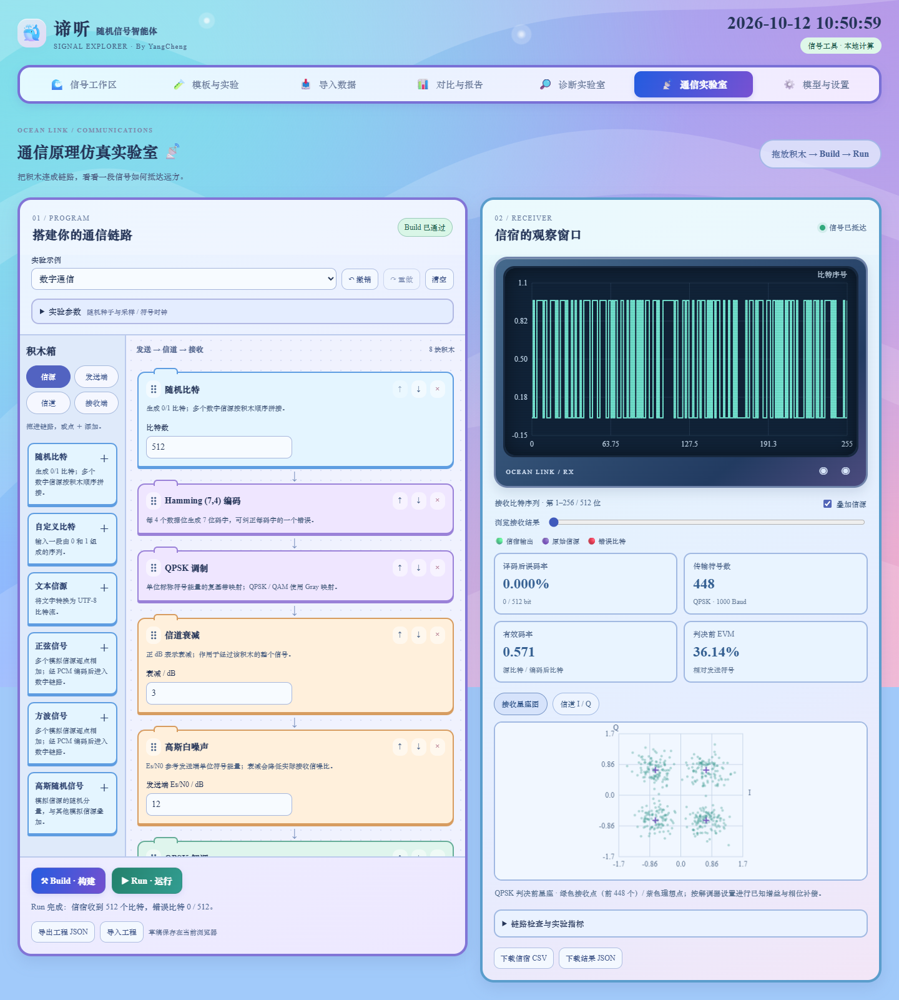
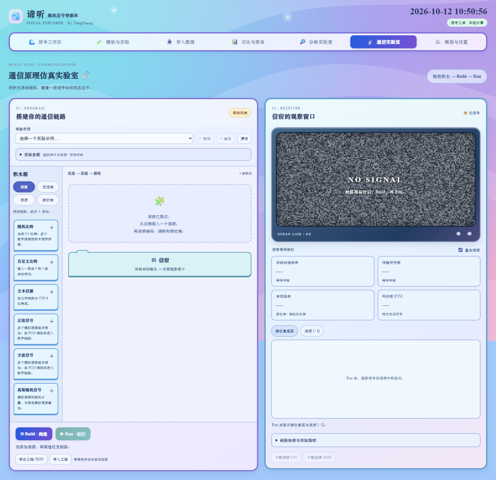

# 通信原理仿真实验室

用积木搭出一条通信链路，再观察信宿收到什么。左侧负责搭建和配置，右侧展示接收波形、误码率与星座图。空白工程只放置信宿，电视窗口显示雪花屏。

本功能已包含在 v0.4.0「通信原理积木编程」部署包中。启动方式和运行依赖保持不变，无需模型 API Key。



## 第一个实验

1. 在 `工程文件/代码` 安装 `requirements-repro.txt`，按 [执行指南](exec.md) 启动服务。
2. 打开 `http://127.0.0.1:8000/#communicationsPanel`，或点击导航栏的“通信实验室”。
3. 选择“数字通信”示例。它连接随机比特、Hamming 编码、QPSK 调制、衰减、白噪声、QPSK 解调、Hamming 译码和信宿。
4. 点击 **Build · 构建**。程序检查输入类型、参数、收发配对和中间数据量，显示逐级检查结果；此时仍是雪花屏。
5. 点击 **Run · 运行**。右侧显示译码后比特，紫线为原始信源，绿线为接收输出，红点标出错误位。拖动滑块可查看整段接收结果。
6. 将噪声积木的 Es/N0 从 12 dB 调低到 0 dB，再 Build、Run，观察误码率和星座散布的变化。

数字通信、模拟信源 + PCM、文字传输三个示例均可修改。固定种子和完整配置能够复现同一次实验，改变种子获得另一组信源与信道随机样本。

## 自己搭建

从积木箱拖动模块到链路中，或点击积木上的“＋”。链路中的拖动手柄与上下箭头用于排序；× 移除模块。信宿始终固定在末端。桌面左右并排，窄屏上下排列，手机可用添加和排序按钮完成操作。

基本顺序为：

```text
信源 → [PCM / 信道编码 / 交织] → 调制 → 信道 → 解调 → [解交织 / 信道译码 / PCM译码] → 信宿
```

方括号表示按实验需要添加。数字信源可以直接进入调制器，模拟信源需要先经 PCM 转为比特。发送端叠加多个编码器时，接收端按相反顺序译码，且重复次数、交织列数、PCM 位数和量程必须配对。例如：

```text
文字 → Hamming编码 → 交织 → BPSK → 白噪声 → BPSK解调 → 解交织 → Hamming译码 → 信宿
```

每条链路有一个调制器、对应的解调器，以及至少一个信道积木；可以选择理想信道。连续的模拟信源逐点相加，连续的数字信源按顺序拼接，二者不能直接混合。信源集中放在开头。

每次修改参数、添加或移动积木，旧构建与旧输出立即失效，重新 Build 后才能 Run。“撤销/重做”最多保留 30 个编辑状态；切换应用分区保留当前工程与运行结果。

## 积木与参数

| 分类 | 积木 | 参数与作用 |
| --- | --- | --- |
| 信源 | 随机比特 | 8–8192 位，等概率生成 0/1。 |
| 信源 | 自定义比特 | 1–8192 个 0/1，可测试已知序列。 |
| 信源 | 文本 | 最多 256 个字符，以 UTF-8、字节内高位在前转换为比特。纯文本信源链路同时显示译码后的文字。 |
| 信源 | 正弦、方波 | 幅值 0–8、初相 −180° 至 180°；频率 0–24000 Hz 且必须低于采样率的一半。方波为采样后正弦符号的 ±幅值，高次谐波可能混叠。 |
| 信源 | 高斯随机信号 | 标准差 0–4，均值为 0；可与其他模拟信源叠加。 |
| 发送端 | PCM | 2–12 位，量程 ±0.1 至 ±32；均匀量化，超量程样本饱和。 |
| 发送端 | 重复码 | 每个比特重复 3、5 或 7 次。 |
| 发送端 | Hamming (7,4) | 4 位数据变为 7 位码字，可纠正每码字的一个错误。 |
| 发送端 | 卷积码 | 码率 1/2，约束长度 3，多项式 (7,5)₈，附加两位零尾终止。 |
| 发送端 | 块交织 | 2–64 列，按行写入、按列读出。 |
| 发送端 | BPSK / QPSK / 16-QAM | 每符号 1 / 2 / 4 比特；单位标称平均符号能量，QPSK 和 16-QAM 使用 Gray 映射。 |
| 信道 | 理想信道 | 原样传输。 |
| 信道 | AWGN 白噪声 | 发送端参考 Es/N0：−10 至 60 dB。 |
| 信道 | 衰减 | 0–60 dB，正数表示衰减；多块总衰减不超过 100 dB。 |
| 信道 | 相位偏移 | −180° 至 180°，旋转复符号。 |
| 信道 | 符号丢失 | 概率 0–1，将符号归零，保持长度和定时。 |
| 接收端 | BPSK / QPSK / 16-QAM 解调 | 最近星座点硬判决，可开关理想已知增益/相位补偿。 |
| 接收端 | 对应译码器 | 多数判决、Hamming 综合征、完整帧硬 Viterbi、解交织、PCM 还原。 |

信道按积木顺序执行。先加噪声再衰减，会把噪声和信号一起衰减；先衰减再加噪声，噪声不随前面的衰减减小。可以放多个信道积木比较顺序的影响。

## 如何理解结果

这是每符号一个复样本的**复基带模型**。I 是实部、Q 是虚部，合在一起描述符号的幅值与相位。当前采用理想符号定时，没有生成射频载波，也没有模拟脉冲成形、频偏、时钟恢复、多径或均衡。

“模拟采样率”和“样本数”确定模拟信源的时间轴；“符号率”确定信道 I/Q 的时间轴。两个时钟独立配置，模拟样本先缓存为有限帧再发送，符号率不改变随机误码概率，也不表示实时传输或连续吞吐量。

### 噪声和补偿

星座码本按等概率符号的平均能量归一化为 Es=1；单次有限 16-QAM 帧的实测平均能量可能略有不同。白噪声按照标称发送能量计算：`N0 = 10^(−EsN0_dB/10)`，I、Q 分量均为独立、方差 `N0/2` 的高斯噪声。因此前置衰减会降低实际接收信噪比。

Es/N0 是每符号能量与噪声谱密度的比值，不直接等于每信息比特的 Eb/N0。对于码率 R、每符号 k 比特的理想平均模型，有 `Es/N0[dB] = Eb/N0[dB] + 10log10(R·k)`；短帧填充和终止位会改变有效码率。[MathWorks AWGN 说明](https://www.mathworks.com/help/comm/ug/awgn-channel.html)

已知增益/相位补偿使用本次信道配置的总复增益相除，不估计真实信道，也不能恢复丢失符号。补偿也会放大已经进入的噪声。星座图画的是**补偿设置生效后的判决输入**；I/Q 图画的是**补偿前的信道输出**，不能把二者当成同一观察点。

### 指标

- **译码后 BER**：错误位数 / 信源位数；模拟信源以发送端 PCM 编码比特为参考。
- **解调后、译码前 BER**：解调位与编码位逐位比较，可观察纠错前后的差异。
- **符号错误数**：硬判决星座索引与发送索引不同的数量，包含最后一个调制填充符号。
- **有效码率**：原始信息位 / 编码后位，包含编码填充与卷积零尾，不计调制器最后的符号填充位。
- **判决前 EVM**：`100% × sqrt(Σ|判决输入−发送符号|² / Σ|发送符号|²)`，按全部符号计算。它描述星座偏差，不是 BER。
- **模拟 RMSE**：信宿还原样本与原始模拟合成信源的均方根误差。无传输误码时仍有 PCM 量化误差；超量程会产生饱和误差。
- **Hamming 非零综合征数**：译码器执行纠错的码字数。多位错误可能误纠正，此数不等于成功纠正的错误数。

接收图每次显示最多 256 点，可用滑块浏览整段；信道图取前 256 个符号，星座散点取前 1000 个符号。指标和 CSV 使用完整帧，未用显示点数代替全部数据。

## 保存与复现

浏览器自动保存编辑草稿，刷新后可继续填写未完成的参数，需要重新 Build。撤销历史与运行结果不跨刷新保留。

- **导出/导入工程 JSON**：保留积木顺序、参数、种子和时钟设置，也可以分享未完成的工程；导入后通过 Build 检查。
- **下载信宿 CSV**：导出全部样本/比特、信源参考及错误标记；模拟样本带时间列。
- **下载结果 JSON**：包括完整工程、逐级类型/数量、全部指标与信宿数组，以及有限长度的信道/星座展示数据。

通信实验室有独立的工程和结果，不改写信号工作区的数据。本轮尚未接入快照库、最近 50 次处理历史或 PDF 报告，使用上述 JSON/CSV 保存通信实验。

## 配置、接口与验证

服务启动时读取 `config/communications.json`。默认限制：32 块积木、合并数字信源 8192 位、模拟 1024 点、中间 65536 点/位、同时运行 2 个实验。所有字段说明见 [执行指南](exec.md)。

| HTTP | 输入 | 输出 |
| --- | --- | --- |
| `GET /api/communications/catalog` | 无 | 积木定义、参数类型/范围、默认值、三个示例与上限。 |
| `POST /api/communications/validate` | `{"program": ...}` | 规范化草稿，允许未填完的参数；不代表链路可以运行。 |
| `POST /api/communications/build` | `{"program": ...}` | 严格检查的 `program`、`token`、逐级 `plan` 与摘要。 |
| `POST /api/communications/run` | `{"program": ..., "token": ...}` | 接收结果、指标和图表数组；必须与 Build 的配置匹配。 |

POST 使用 `Content-Type: application/json`。参数/链路/token 错误返回 400，并发已满返回 429。Build 的 token 是规范化工程的 SHA-256，用于配置一致性检查；服务不保存编译会话，也不执行用户代码。

外部自动化可用上述接口配置和运行，并使用浏览器定位 `#communicationsPanel`、`#cmBuild`、`#cmRun` 操控界面，再对可见分区截图。数值验收脚本为 `python scripts/test_communications.py`；日志覆盖到 `logs/communications/latest.log`。浏览器验收与截图位置见 [执行指南](exec.md)。

空白工程效果：


