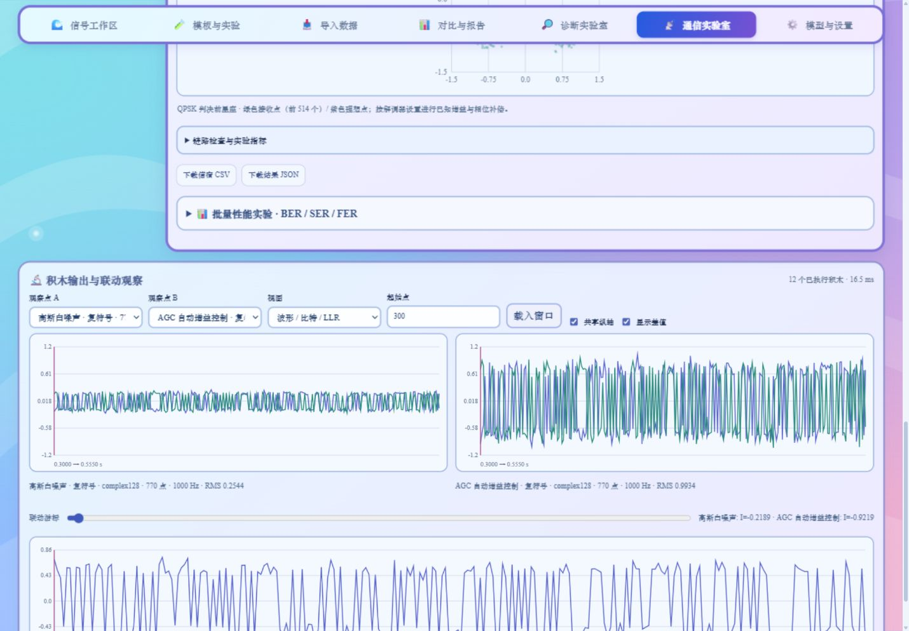

# v0.4.4 · 积木编程体验更新 🌊

保留海洋配色、六类积木、Build/Run、排序拖放、撤销重做、全部旧制式和 schema 1 工程。现在共有 **130 个可添加模块、固定信宿和 54 个示例**。

## 从目标开始 🧭

积木工坊支持中文名称、英文 kind、算法缩写和描述全文搜索；多词按交集匹配。收藏和最近 16 个模块随完整工程保存。实验入口提供文字、纠错、同步、多径均衡、OFDM 和模拟调制示例。勾选“添加到选中积木后”可在当前位置插入。

链路显示输入/输出类型、实际长度、波形采样率与 RRC 群时延，参数面板下显示检查结果；Build 错误定位到对应积木。运行后的观察点进一步显示真实长度、数值类型、RMS、处理耗时和数据摘要。“补齐接收链路”按发送端添加匹配滤波、定时/载波/帧同步、OFDM 接收、解调和逆序译码。已有配置保留；配对参数联动同步线路码、信源编码、交织和纠错参数，纯 AWGN 链路同步软解调噪声方差。

## 逐块执行与联动观察 🔬

Build 后点击“开始单步”。任务在信源执行前暂停；“下一积木”实际计算一块后再次暂停。“继续”“暂停”“停止任务”控制后台任务，页面保持响应。未执行的积木不会预先产生观察数据；调试等待 180 秒后释放任务。

每块输出都可选为 A/B 观察点，包含比特、LLR、实/复符号、波形和模拟样本。波形、I/Q 星座、窗口 FFT 共用观察点；A/B 共享时窗、纵轴和游标，可显示同类型输出差值。窗口按两点各自采样率换算；滤波器边界、前导截取和接收同步产生的序列起点需要结合模块参数解释。FFT 是当前窗口的双边周期图，不是整帧 Welch 估计。

起始点支持读取完整内部数组的后续窗口，每次最多 1024 点。保留最近任务的观察数据；服务重启后保存的首窗仍能查看，完整数组需要重新运行。📌 标记观察点会写入工程。

## 工程、快照与组合积木 🗂️

- 工程名称、当前链路、分支、组合模块、收藏、观察点、结果与扫描曲线一起保存在 schema 2 文档。旧 schema 1 导入继续使用。
- “保存快照”保存到当前会话的工程库；已有工程编辑后自动保存。每会话最多 30 个工程，每工程保留最近 10 个历史快照。保存采用版本检查，避免另一窗口的新版本被覆盖。
- “复制工程”创建独立副本；打开历史快照后保存会创建新工程。完整 JSON 可在另一台机器导入并恢复参数与结果。
- 勾选相邻积木或在编程区空白处框选，Shift 点击可连续选择。指定组合名称及对外参数后封装，支持折叠、展开、解开和撤销。
- “我的组合积木”保存最多 16 个模块模板。复用时生成新积木 ID；展开后编辑内部模块，或直接编辑暴露参数。组合是工程视图结构，执行时保持原链路顺序。

工程库路径为 `data/communication-projects/<会话哈希>/<工程ID>.json`。保存用临时文件原子替换；单文档最多 8 MiB。浏览器同时保留完整草稿，存储不足时可保存到服务端或导出。

## 同一信道接收分支与自动对照 🌊

可保留 2–4 条接收分支，发送端与信道全局参数自动联动。流程图显示共同发送/信道及分开的接收处理；切换分支编辑接收机后重新 Build。

“运行共享信道对比”只允许信源、发送处理、信道与全局参数完全相同的前缀。第一个分支记录真实数组，后续分支重放同一前缀数组，校验形状与类型，结果包含逐块 SHA-256。每条分支的内部输出也可载入联动观察，比较 BER/EVM。

自动对照提供卷积码硬/软 Viterbi、已有均衡器关闭/开启，以及无信道编码/Hamming/卷积码。前两种使用相同接收样本；不同编码改变发送长度和码率，使用相同随机种子系列、信息比特 Eb/N0 标定的独立实验，分别累计性能曲线。

## 通用扫描与检查点 📈

扫描可选择任意数值或枚举参数，也支持全局 seed、采样率、样本数和码元率；输入范围/步长或逗号分隔值。每个候选先 Build，通过后逐帧累计 BER/SER/FER、95% Wilson 区间及 RMSE。软判决 AWGN 方差随 SNR 更新。Eb/N0 仅用于噪声参数，包含公共前导、导频、CP 和填充等实际发送能量。

进度实时显示已完成帧数；停止保留部分统计和准确帧序号。点击“续跑扫描”从检查点继续，不重复计数；服务重启后仍可恢复。每会话保留最近 30 个检查点，位于 `data/communication-jobs/<会话哈希>/<任务ID>.json`。单次运行最多 40 秒，21 点、100 帧/点、总共 300 帧；续跑可继续累计到原定帧数或目标错误数。

最多保留 6 条对比曲线，按相同横轴分组显示；RMSE 用线性轴，误码指标用对数轴，零错误用置信上界绘图。完整工程和扫描 JSON 保存参数、计数及种子策略；CSV 导出数值统计。

## 保持状态的多帧执行 🐾

“保持状态运行”连续执行 1–100 个包，每帧使用 seed + 帧序号，并保留 AGC 增益、复数定时环周期/相位、载波 PLL 相位/频率、复数线性/DFE/CMA/FSE 权重与协方差、衰落散射相位、频偏/相位噪声相位、多径输入尾部及突发噪声状态。显示逐帧 BER/EVM、状态数量和累计 BER/SER/FER。

这是带公共前导的多包实验。包内前导/导频按配置重新发送，帧捕获重新执行；编码器、有限帧成形滤波与旧实基带内部接收器仍按包初始化。没有将任意旧积木变成逐样本无限流；需要检验指定算法的跨包收敛时，使用相应独立复基带接收积木。

## 新增算法模块 🧮

| 积木 | 输入、原理和参数 |
| --- | --- |
| AGC 自动增益控制 | 复符号/波形，按输出功率误差迭代对数增益；目标 RMS、步长。增益跨帧保存。 |
| 噪声方差估计 | 公共训练序列的 LS 增益拟合后残差，使用 N−1 自由度；或最近星座判决残差。估计 N0 可用于软解调。 |
| 有理数重采样 | up/down 采样率转换，32 点加窗 sinc 插值和降采样抗混叠；后续接收使用新采样率及每码元采样点数。 |
| T/2 分数间隔均衡 | 匹配滤波后接入，公共前导捕获，半码元间隔复数 NLMS，训练后判决引导；半抽头数和步长，权重跨帧保存。 |
| OFDM 频偏估计与补偿 | CP 与相隔 NFFT 样本的相关相位估计小数频偏，公共训练搜索整数子载波偏移；利用 CP 内冲激响应能量集中度抑制衰落误捕获。 |
| OFDM 导频跟踪接收 | 公共训练初始估计，逐 OFDM 符号梳状导频 LS；频域插值或有限长度 DFT LS，跟踪增益和正则均衡。 |
| 独立路径时变多径 | 每条路径独立 Rayleigh/Rician 散射；可配延迟、相对功率、多普勒及 K 因子，跨包保留散射状态及输入尾部。 |
| Markov 突发噪声 | 好/坏两状态转移 pGB/pBG，分别设置 SNR，保留坏态并显示状态轨迹；用于交织和纠错实验。 |

AGC 不使用已发送负载；训练估计只读取实际发出的公共前导。判决残差在低 SNR 下有偏，导频跟踪依赖相干时间与路径长度，DFE/判决引导均衡可能传播误判。相关实验提供实际统计结果。

新增示例为 `agc_soft`、`resample_receiver`、`fractional_equalizer`、`ofdm_cfo_tracking` 和 `burst_interleave`。

## 实验报告 📄

点击“实验报告”预览后下载 PDF，包含链路矢量图、模块参数、实际误码/RMSE、分支比较、扫描曲线及置信区间、结论、随机种子和构建令牌。复用既有中文字体和报告并发池，生成的中文字可检索复制。结果必须匹配当前链路；多帧末帧按帧序号核对种子。完整 JSON 同时用于精确复现。

## API、配置、启动与验证 ⚙️

启动：`python server.py --host 127.0.0.1 --port 8000`，打开 `/#communicationsPanel`。原 validate/build/run/sweep 请求格式保留。新接口位于 `/api/communications/`，除 describe/receiver/pair 需要 program 外，均可带 session_id：

| POST 操作 | 请求 / 返回 |
| --- | --- |
| describe、receiver、pair | program → 类型提示与错误 / 补齐链路 / 联动参数 |
| document-check | document → 规范化完整工程 |
| project-list / project-save / project-load | 会话工程列表 / document、可选 id/version → 保存快照 / id、可选 version → 快照 |
| job-start | kind(run/debug/sweep/branches/experiments/continuous)、payload(program/token 等) → 任务 |
| job-status / job-control | id → 状态与结果 / id、control(step/continue/pause/cancel/resume-sweep) → 控制 |
| window | id、block_id、offset、count、可选 branch 序号 → 实际内部数组窗口 |
| report-preview / report-pdf | document → 摘要 / PDF |

`config/communications.json` 新字段：max_capture_bytes=67108864（每次运行内部数组容量）、max_projects=30、max_project_bytes=8388608、max_project_versions=10、max_branches=4、max_continuous_frames=100、max_studio_jobs=4（排队/运行/暂停总数）、max_debug_idle_seconds=180。其余限额和默认值保持原配置；concurrent_runs=2 限制实际同时仿真。

执行 `python scripts/test_communications_experience.py`，24 项新增测试覆盖观察/旧结果逐字段一致、单步/取消/窗口、工程历史/隔离/冲突、分支样本哈希、扫描续跑/重启、多帧状态、AGC/N0/重采样/OFDM 和中文报告。既有 191 项测试及 540 组数值基准继续执行。新增套件已接入干净部署验证与 Windows/Linux Python 3.12–3.14 CI；Docker 冒烟包含新示例、工程保存及重启恢复。

日志同名覆盖：`logs/communications/experience.log`，完整测试 `logs/communications-v044/tests.log`，真实浏览器 `logs/communications-v044/browser.json`，服务同目录 server*.log。报告渲染及隔离数据位于 `debug/communications-v044/`；发布验证位于 `logs/release/`，汇总为 Release 附件 verification.json。

算法参考：[AGC](https://www.mathworks.com/help/comm/ref/comm.agc-system-object.html)、[自适应与分数间隔均衡](https://www.mathworks.com/help/comm/ug/adaptive-equalizers.html)、[OFDM 频偏](https://www.mathworks.com/help/comm/ref/ofdmcfoestimate.html)、[导频信道估计](https://www.mathworks.com/help/comm/ug/ofdm-channel-estimation.html)。具体离散实现以本项目公式及数值验收为准。

CLI 示例：`python scripts/run_communication_sweep.py --preset text --global-parameter seed --values 7,42,2026 --frames 5`；`--block-id` 和 `--parameter` 选择具体积木参数，`--resume outputs/communications/sweep.json` 从已保存统计继续。

[示例实验报告](../../../docs/communication-report-example.pdf)
